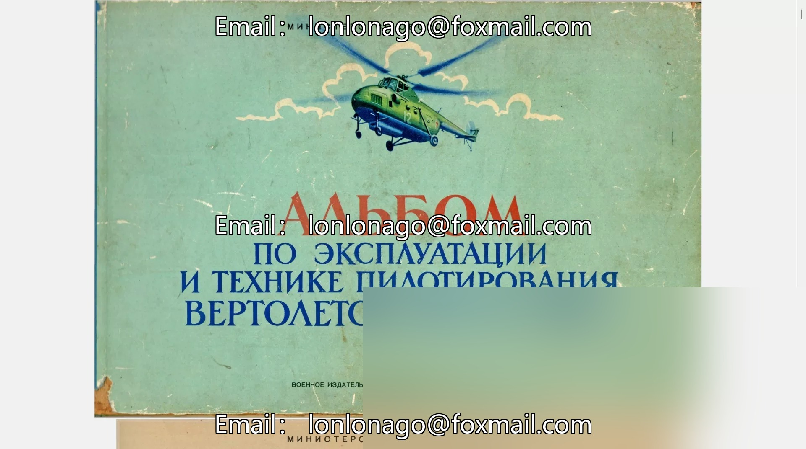
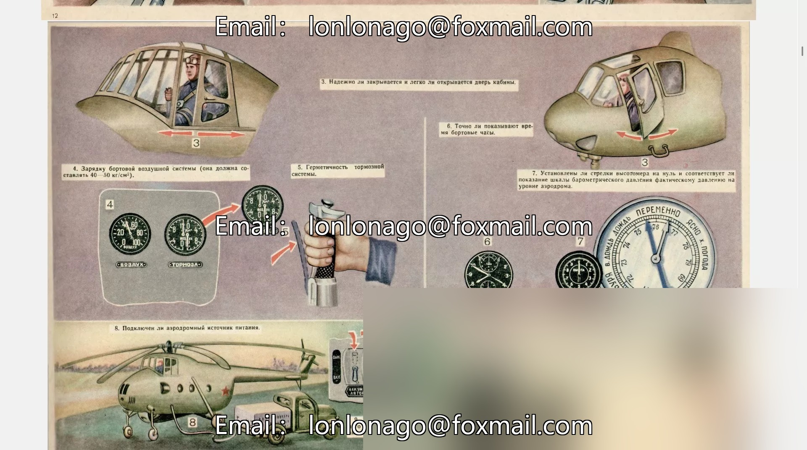
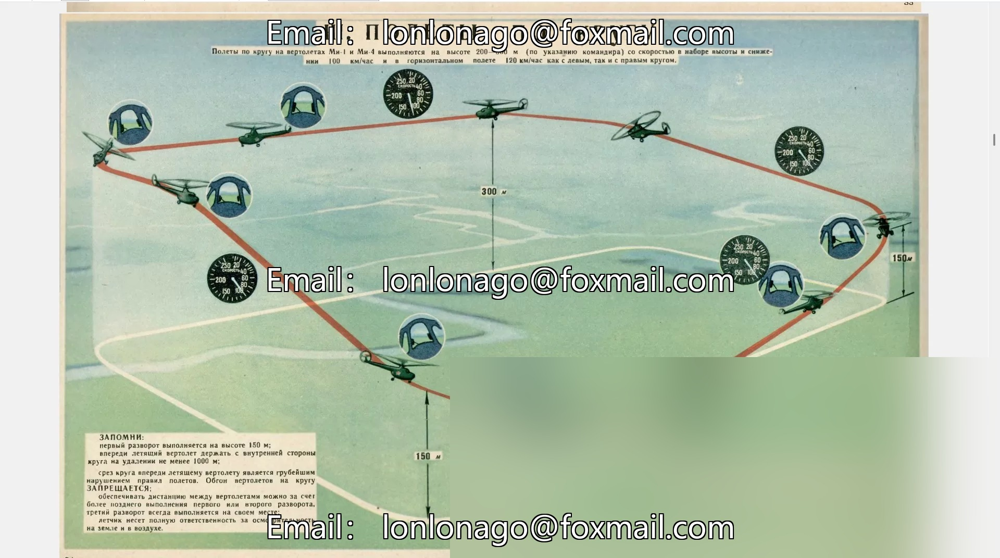
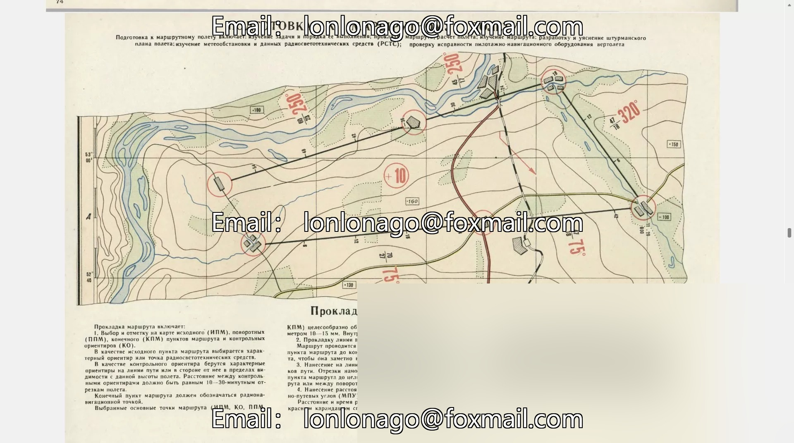

# The PDF of "M-4 and M-1 Helicopter Operation and Driving Technical Chartbook" from the Soviet Defense Ministry

## Body

The PDF of the Soviet Ministry of Defense's "M-4 and M-1 Helicopter Operation and Driving Technical Manuals," 149 pages, in original Russian, covering helicopter operation, maintenance, and flying technology, suitable for research and reference by military enthusiasts, aviation history, and tactics.
The materials are in , and they are non-refundable and non-returnable upon sale. For direct photography, please contact privately for any issues.

This is the Soviet Ministry of Defense《M-4 and M-1 Helicopter Operation and Driving Technical Catalogue》PDF, 149 pages, in Russian original, covering helicopter operation, maintenance and flying technology, suitable for military enthusiasts, aviation history and tactical research; the material is sold.

<!-- AI_ENRICHED -->

## Images

## Payment

Here is a pay link on Stripe ( https://buy.stripe.com/3cs8yP7sY87d0vu9AB ). Please contact me lonlonago@foxmail.com after funding $89, and I will send you a complete data files , thank you!

